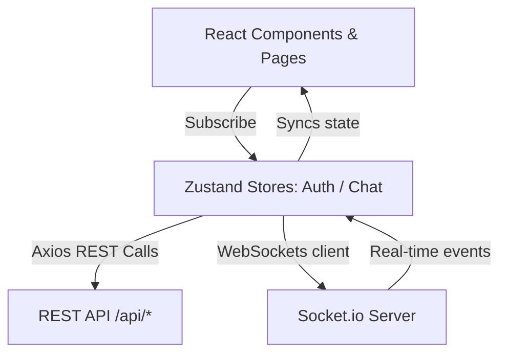

# EchoChat - Premium Real-Time Chat Application

EchoChat is a premium, high-fidelity real-time chat application featuring 1-to-1 and group conversations, built with Next.js (App Router), TypeScript, Tailwind CSS v4, Zustand, and Socket.io. It showcases a premium dark glassmorphism SaaS visual theme combined with clean state management, instant socket updates, and a live interactive chat simulator on the landing page.

---

## Features

- **One-Step Authentication**: Instant login and registration using phone number and name.
- **Direct & Group Chats**: Create and manage 1-to-1 and group chat rooms seamlessly.
- **Real-Time Synchronization**: Instantly sync new messages across users using WebSockets (Socket.io) with reconnect/disconnect handling and clean event cleanup.
- **Smart Auto-Scroll & Scroll Lock**: Chronological message display with automatic scroll-to-bottom on new messages when near bottom, a dynamic "New messages" floating button for users reading history, and scroll state preservation.
- **Unread/Seen Badges**: Client-side unread message count badges that auto-reset when viewing the conversation, alongside delivery checkmarks (✓) inside message bubbles.
- **Active Status Cues**: Pulsing green active presence indicator and `• Active` tags on direct chat headers.
- **Responsive Web Design**: Fluid mobile-first UI tailored for desktop, tablet, and mobile browsers with large touch targets and no horizontal overflows.
- **Interactive Chat Playground**: Fully interactive chat simulator on the landing page where users can type messages and get responsive, simulated real-time replies from a virtual assistant before logging in.

---

## Tech Stack

- **Framework**: Next.js 15+ (App Router)
- **Language**: TypeScript (Strict Null Checks, type-safe API states)
- **Styling**: Tailwind CSS v4 (Glassmorphism theme tokens, dark mode palette)
- **State Management**: Zustand (Centralized reactive stores for auth, conversations, and sockets)
- **Networking**: Axios client instance with request/response interceptors for JWT injection and automated 401 redirection
- **WebSockets**: `socket.io-client` for real-time bi-directional events
- **Animations**: Framer Motion (Smooth page transitions, modal entries, and typing indicators)
- **Icons**: Lucide React
- **Notifications**: `react-hot-toast` for inline status feedback

---

## Architecture

EchoChat implements a decoupled client-server architecture using Next.js for rendering and routing, Zustand for reactive state centralization, and a custom API utility layer for networking.



Key Architectural Patterns:
1. **Zustand store as single source of truth**: Restores auth token on app load, holds socket instances, listens to incoming events (`message:new`, `conversation:updated`), and updates local states reactively.
2. **REST for Writes, WS for Pub/Sub**: Message dispatching is routed via REST requests (`POST /messages`) to cleanly capture status codes, validation errors, and loading states, while incoming messages are captured using Socket.io subscriptions.

---

## Folder Structure

```text
src/
├── app/                  # Next.js App Router Pages
│   ├── chat/             # Chat Dashboard Container
│   │   └── page.tsx      # Main Chat Application Interface
│   ├── login/            # Authentication Interface
│   │   └── page.tsx      # Login & Signup Form
│   ├── layout.tsx        # HTML Page Wrappers & Global Fonts
│   └── page.tsx          # Creative Landing Page & Simulator
├── components/           # Reusable UI Elements
│   ├── AppInitializer.tsx# Restores session store & connects WS
│   └── chat/             # Chat specific components
│       ├── Sidebar.tsx   # Chats lists, user search, group creation
│       ├── ChatArea.tsx  # Message history, header, input form
│       ├── GroupCreateModal.tsx   # Create new group modal dialog
│       └── GroupSettingsModal.tsx # Manage group members & leave group
├── hooks/                # Custom React Hooks
│   └── useScroll.ts      # Custom scrolling hook for message windows
├── services/             # API Client & Sockets Configuration
│   ├── api.ts            # Axios instances with Authorization Interceptors
│   └── socket.ts         # Socket.io connection helper
├── store/                # Zustand State Stores
│   ├── useAuthStore.ts   # Session token, user metadata, and logout flow
│   └── useChatStore.ts   # Sockets listeners, messages, and room states
└── styles/               # Styling sheets
    └── globals.css       # Tailwind entry point and design system
```

---

## Getting Started

### Installation

1. Clone the repository:
   ```bash
   git clone <your-repository-url>
   cd <repository-folder>
   ```

2. Install dependencies:
   ```bash
   npm install
   ```

### Environment Variables

Create a `.env.local` file in the root directory (refer to `.env.example`):
```env
NEXT_PUBLIC_API_URL=https://frontend-task-chatapp.onrender.com/api
NEXT_PUBLIC_SOCKET_URL=https://frontend-task-chatapp.onrender.com
```

### Development

To run the development server:
```bash
npm run dev
```
Open [http://localhost:3000](http://localhost:3000) to view the application in the browser.

### Production Build

To compile and launch the production-optimized build:
```bash
npm run build
npm run start
```

---

## API Documentation

The complete API schema, endpoints, authorization headers, request payloads, and WebSocket events are documented in the [API Documentation](file:///e:/Task/API_DOCUMENTATION.md) file.

---

## Live Demo

- **Part 1 Chat Application**: [https://echochat-frontend-kappa.vercel.app/chat](https://echochat-frontend-kappa.vercel.app/chat)
- **Part 2 Landing Page**: [https://echochat-frontend-kappa.vercel.app/](https://echochat-frontend-kappa.vercel.app/)

---

## Demo Accounts & Testing Guide

For evaluation purposes, the following pre-created test accounts are available to verify multi-user real-time chats, socket connections, and group room creation.

> [!TIP]
> To test real-time chat sync, open the application in **two different browser sessions** (e.g., standard browser window and an Incognito window) and login to each account respectively.

### Account 1
- **Phone**: `+15550002221`
- **Name**: `Test User 1`

### Account 2
- **Phone**: `+19991234567`
- **Name**: `Test User`

*Note: No separate registration flow is required. If you enter a new name and a unique phone number during login, the backend API automatically registers and creates the account.*

---

## GitHub Repository

GitHub Repository Link: [https://github.com/Ahteshamull/echochat-frontend](https://github.com/Ahteshamull/echochat-frontend)

---

## Thought Process

### 1. Why the Architecture was Chosen
Next.js was selected due to its out-of-the-box routing system and developer productivity. The landing page (`/`) acts as a fast, statically rendered landing page, while `/chat` functions as a full Single-Page Application (SPA) dashboard protected by token validation. 

### 2. Why the Selected Libraries were Chosen
- **Zustand**: Selected over Redux because of its ultra-lightweight size, zero-boilerplate setup, and performance. It makes managing WebSocket connections easy because we can hold the socket instance globally and invoke state setters directly from socket listener callbacks.
- **Axios**: Selected for its request/response interceptors. The request interceptor automatically injects the user's JWT into the authorization headers, while the response interceptor listens for `401 Unauthorized` errors to log out expired users instantly.
- **Framer Motion**: Selected to provide smooth transitions, modal entries, and chat bubble entry animations, matching the premium SaaS visual requirements.

### 3. Important Trade-offs
- **REST vs Socket for Message dispatching**: While we could send messages directly through websockets (`message:send`), we chose to use REST (`POST /messages`). REST API calls return native HTTP status codes (making field validation errors, rate limits, and network errors easy to capture and handle inside the input UI) and provide reliable loading/disabled state bindings during dispatch.
- **Client-Side Unread States**: Since the backend does not store a read/unread flag for messages in the database, we built client-side tracking. If a new message is received via WebSockets in a background conversation, the store toggles `hasUnread: true` for that room, rendering a blue unread badge in the sidebar. This state resets once the user clicks on the conversation.

### 4. How Authentication was Handled
We implemented a single-step phone/name login. The server returns a JWT bearer token upon success. The client caches this token in `localStorage` inside the `useAuthStore` persisted state. A global `AppInitializer` component intercepts the app mounting process: if a token exists, it restores the session, launches the WebSocket connection, and redirects to `/chat`. If no token exists or if an API response returns `401 Unauthorized`, the user is logged out, cache is cleared, and they are redirected to `/login`.

### 5. How Real-Time Messaging was Handled
Real-time messaging is handled via Socket.io. Sockets are initialized inside `useChatStore` using the authenticated token. To prevent multiple socket connections on component re-renders, the socket instance is cached globally in the store and disposed of only on user logout. 
Incoming events (`message:new`) are normalized (mapping differences between Socket payload structure and REST response schema) and appended to the active chat history. If the incoming message belongs to a conversation not currently loaded in the sidebar, a background fetch is triggered to sync the conversations list.

### 6. How Auto-Scroll Behavior was Implemented
We built a custom scroll hook ([`useScroll.ts`](file:///e:/Task/src/hooks/useScroll.ts)). When a conversation is loaded or when the current user sends a message, the container scrolls to the bottom instantly.
When a new message arrives from another participant, the hook checks if the user is already scrolled near the bottom (within `150px`). If yes, it auto-scrolls down. If the user has scrolled up to read older history, the hook suppresses auto-scroll, increments a `newMessagesCount` state, and displays a floating "New Messages" indicator. Clicking this indicator smoothly scrolls them to the bottom and resets the count.

### 7. Why the Landing Page Design was Chosen
We targeted a high-premium, modern SaaS look. The design features a dark obsidian background (`#080A10`) layered with subtle glowing indigo/teal radial gradient backgrounds and sharp, thin-bordered glassmorphism cards. Instead of static screenshots, we created a live interactive simulator showing chat bubbles, typing states, and automated chatbot responses to increase visitor conversion rates.

### 8. Responsive Design Decisions
We followed a Mobile-First layout. On mobile devices, the sidebar (chat list) and chat panel toggle viewports (clicking a conversation hides the sidebar and opens the chat panel, and a "Back" button returns them to the list). Touch targets are padded to at least `44px` to prevent misclicks on touchscreens, and all horizontal overflows are strictly clipped.

---

## AI Usage

We maintain transparency regarding the utilization of AI tools in this project:

- **AI Tools Used**: Gemini Code Assist (integrated inside IDE) and GitHub Copilot.
- **Applications**:
  - Code scaffolding for custom Zustand store configurations.
  - Generating test scripts inside `scratch/` to investigate the backend API.
  - Writing helper functions for formatting dates.
  - Creating Tailwind transition animations for glassmorphic elements.
- **AI Output Modifications**:
  - The AI generated message mock data with hardcoded timestamps; we replaced this with dynamic `new Date().toISOString()` mappings to prevent rendering mismatches.
  - AI proposed importing SVG icons from Lucide React that triggered Turbopack compilation failures; we replaced them with direct inline SVG elements.
- **AI Suggestions Rejected**:
  - We rejected the suggestion to poll `GET /messages` every 5 seconds for message syncing, instead insisting on a strict WebSocket listener system to conserve client battery life and server bandwidth.
  - We rejected generic mockup page sections (FAQ, Testimonials) to keep the landing page clean, concise, and focused on assignment specifications.

---

## API Issues & Workarounds

During the implementation, we discovered and bypassed the following server-side API inconsistencies:

1. **Schema Property Mismatch (REST vs WebSockets)**:
   - *Issue*: The REST endpoint returns message items with `_id` and string `createdAt` (ISO String). However, the Socket.io `message:new` event returns items with `id` and numerical `createdAt` (Unix timestamp).
   - *Workaround*: We built a normalizer inside the socket listener in [`useChatStore.ts`](file:///e:/Task/src/store/useChatStore.ts). The listener maps `incoming.id` to `message._id` and formats numerical timestamps into standard ISO strings: `new Date(createdAt).toISOString()`. This prevents key warnings and duplicate rendering bugs in React.
2. **Missing Group Creation Event**:
   - *Issue*: When User A creates a group and adds User B, the server does not emit a socket event to User B's socket indicating they were added to a new group.
   - *Workaround*: When User A sends the first message inside the new group, the server emits `message:new` for that message to User B. User B's store checks if the message's `conversation` ID is in their sidebar list. If it is missing, the store automatically fetches the conversations list, bringing the group into User B's sidebar dynamically.
3. **Invalid Date for Group Creation**:
   - *Issue*: The group object returned by the API does not contain a `createdAt` field; it only returns `updatedAt`.
   - *Workaround*: We updated the Group Settings UI date formatter to fall back to `conversation.updatedAt` to prevent "Invalid Date" errors: `new Date(conversation.createdAt || conversation.updatedAt)`.
4. **Render Free Tier Cold-Start**:
   - *Issue*: The Render hosting provider sleeps after 15 minutes of inactivity, causing the first API request (Login) to take up to 50 seconds to respond.
   - *Workaround*: We added an active API ping on mount. If the connection fails or takes time, a loading screen displays: "Server waking up, please wait..." to keep the user informed.

---

## What I Would Improve With More Time

1. **Virtualized Message List**: Use a windowing library like `react-window` to handle conversations with thousands of messages without causing browser page lag.
2. **Interactive Typing Events**: Emit `typing:start` and `typing:stop` socket events to show real-time typing indicators in the chat header instead of a static status.
3. **Image & File Sharing**: Extend the message schema to support file attachments, utilizing a cloud storage service like AWS S3 or Cloudinary.
4. **Offline Cache Support**: Implement Service Workers and IndexedDB (via Dexie.js) to store message history locally, allowing users to read conversations offline.
